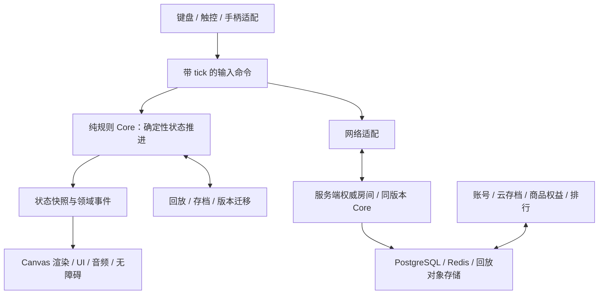

# 五平台原创方块消除游戏：阶段 1 待确认方案

版本：0.1 · 2026-10-26 · 历史方案；用户已确认 TypeScript 路线并授权开始开发。阶段 2 与 Web 初版进度见 verification/phase-2-and-web.md；名称、市场、商业 SDK 仍待后续确认。

后续命名更新：按用户提供的候选名称，中文显示名已改为《方块消消看》，英文暂保留 DropGrid Echo。下文保留最初提案记录；新名称尚未做商标与商店查重。

本文件修订需求中的歧义，给出架构、范围、验收和发布条件。下文“建议”均为待确认选项，不代表用户已同意。项目根目录现有 repo/、dist/，检查时均为空，未发现工程或 AGENTS.md。

## 1. 建议确认的产品方向

| 决策 | 建议默认值 | 说明 |
|---|---|---|
| 游戏名 | 暂定《落格回响》 / DropGrid Echo | 仅工作名，未做商标、商店重名、域名检索；不能视为已获可用性确认 |
| 用户 | 休闲大众优先，兼顾进阶玩家 | 新手引导、舒适触控先行；竞技规则独立配置 |
| 核心卖点 | 操作流畅、原创视听、五端一致规则 | 第一版不宣传尚未实现的账号或跨端互通 |
| 技术路线 | B：TypeScript 纯逻辑核心 | 当前二维玩法和 Web 优先顺序下，更便于轻量交付与服务端同源重算 |
| 微信形态 | 微信小游戏 | 小程序作为另选，不同时维护两个微信客户端 |
| 商业模式 | 免费基础内容 + 外观内购；可选激励广告 | 首个可玩版不接真实支付/广告；上线阶段再接平台 SDK |
| 公平性 | 所有计榜、竞速、对战禁止复活及付费强度 | 广告复活仅限不计榜练习；不出售影响竞技的道具 |
| 首发市场 | 待确认：中国大陆 / 海外 / 两者 | 影响账号、数据区、资质、隐私、支付和发布成本 |

## 2. 对原需求的必要修订

1. **原创并不自动排除侵权风险。** 将“Guideline 机制不受保护，可自由实现”改为“规则思想与具体表达需要分别评估；不承诺整套近似实现天然无风险”。品牌、块体配色映射、整体界面、预览布局、音效、动效等均独立设计，发布前进行目标市场知识产权审查。产品不使用第三方品牌、Logo 或声称官方认证；内部法律来源允许保留案件名称。[美国版权局说明](https://www.copyright.gov/help/faq/faq-protect.html)、[相关法院判决原文](https://www.govinfo.gov/content/pkg/USCOURTS-njd-3_09-cv-06115/pdf/USCOURTS-njd-3_09-cv-06115-0.pdf)。
2. **采用本项目版本化规则，不声称通过官方 Guideline 认证。** 180° 旋转、Mini、Master、Blitz、攻击表等不是一个名称就能完整定义的规格。所有客户端、回放、排行和服务器绑定 rulesetId 与版本。
3. **Electron 只用于桌面。** Android/iOS 采用 Capacitor 原生工程；不同时引入 React Native，避免再维护一套渲染和桥接体系。[Electron 平台说明](https://www.electronjs.org/docs/latest/)、[Capacitor 环境要求](https://capacitorjs.com/docs/getting-started/environment-setup)。
4. **“商用品质”改为可测验收门槛。** 代码完成、构建成功、真机验证、签名分发、平台审核通过、获准商业运营是不同状态，分别记录；不能以源代码或构建脚本替代实测安装产物。
5. **覆盖率目标聚焦规则。** Core 可达纯逻辑语句/分支覆盖目标 100%，任何排除项须有理由；同时使用属性测试、反例和跨端回放验证。覆盖率本身不等于规则正确，不靠空测试或过度 mock 达标。
6. **性能目标附带测量条件。** 60fps、冷启动与包体都是预算，必须给出指定设备、网络、缓存状态和构建版本。微信主包 <4MB 先作为内部预算，不将其写成对所有平台版本恒定的官方上限。
7. **广告形式消除冲突。** 默认无自动插屏、无局中 Banner、无强制广告；激励视频必须主动触发并明确奖励。不承诺所有平台都有相同广告库存或支付能力。
8. **合规从设计阶段介入。** 阶段 5 才接商业 SDK，但阶段 1 就定义市场、数据最小化和资质依赖。国内公开运营不能以“先免费”推定免审批；匿名身份也不能替代适用的实名要求。[出版审批办事指南](https://zwdt.sh.gov.cn/govPortals/bsfw/item/a3457a29-b01d-4c8b-886d-ef6b87dafeff)、[未成年人网络游戏管理通知](https://www.nppa.gov.cn/xxfb/tzgs/202108/t20210830_666285.html)。
9. **不预写统一 30% 平台费率。** 内购、广告、订阅的政策与费用按市场、资格、平台及提交日期核验，独立配置商品目录、权益与退款逻辑。

## 3. 两条路线比较与建议

| 维度 | A：Unity / C# | B：TypeScript / Canvas |
|---|---|---|
| 核心 | 纯 C# 程序集，隔离 UnityEngine | 纯 TS 包，隔离 DOM、wx、Node 和任何 UI |
| Windows | 原生 Player，按需要选择 IL2CPP；NSIS 安装器 | Electron + 本地资源 + NSIS 安装器 |
| Android / iOS | Unity 原生导出 | Capacitor，输出 Android 与 Xcode 工程 |
| Web | Unity Web 构建，需检验移动浏览器支持与启动成本 | Vite 构建，Canvas 2D + Web Audio |
| 微信 | 经微信 Unity/团结转换方案适配，锁定引擎/SDK兼容版本 | 独立小游戏入口 + wx Canvas、音频、存储和网络适配 |
| 视听 | 编辑器、特效、动画和资源工具成熟 | 二维网格负载小，可用程序化美术；特效及音频工具需自行组织 |
| 包体和启动 | 引擎运行时有固定成本，小游戏需专项验证 | Web/小游戏运行时较轻；Electron 桌面包仍较大 |
| 服务端校验 | .NET 重用核心，或独立规则服务 | Node.js 直接重用 Core，便于同版本输入重算 |
| 长期成本 | 引擎授权、插件、升级和平台适配成本 | 多宿主生命周期、WebView 输入/音频和真机调优成本 |
| 更适合 | 团队熟悉 Unity，计划强化 3D/重特效或已有原生 SDK 集成 | 本项目二维玩法、Web/微信优先、希望快速验证手感 |

**本项目建议 B。** 这是基于游戏负载与交付顺序的工程判断，仍需阶段 2 平台探针确认；不是保证所有平台自动达到同一性能。若确定采用重度 3D、已有 Unity 团队或强依赖 Unity 插件，可改选 A，须在阶段 2 前决定，避免维护双核心。

Unity 微信路线需要适配，不是直接勾选五平台即可完成。参考[微信官方组织仓库](https://github.com/wechat-miniprogram/minigame-unity-webgl-transform)及[团结引擎转换 SDK 文档](https://docs.unity.cn/cn/tuanjiemanual/1.6/Manual/WechatSDK.html)，开发时验证当期有效工具链并锁版本。

### 微信小游戏与小程序取舍

- 小游戏：适合持续渲染、游戏生命周期和游戏相关平台服务；需要 wx 接口，不能把浏览器 DOM 页面直接搬入。
- 小程序：更适合业务页面和服务流程；Canvas 可承载玩法，但需要额外页面、触控、音频和生命周期适配，不能借此绕过游戏类目和运营要求。
- 两者都可复用 TS Core；渲染、输入和平台服务分别适配。本项目建议只交付小游戏这一微信形态。

## 4. 规则契约 v1（建议冻结的行为）

这些是项目规则的提案，不冒充受保护的官方规范。阶段 2 编码前将全部矩阵、踢墙偏移、坐标、出生点和边界样例落入独立规则文档与测试夹具。

### 棋盘、输入与时间

- 10×20 可见格 + 20 行隐藏缓冲；x 向右、y 向下。7 种四格块，独立定义出生中心、四方向矩阵，碰撞包含隐藏区。
- 出生位置重叠立即结束；锁定并清行后仍有占用格在可见区域上方则结束。超出缓冲区视为碰撞。此选择属于本项目 top-out 规则。
- 带 seed 和可序列化状态的整数 PRNG + Fisher–Yates 7-Bag；禁止 Math.random() 进入核心。垃圾行另用独立随机流，不影响出块顺序。
- 默认显示 5 个预览；Hold 每次锁定后恢复一次交换机会；Hold 取出的块恢复出生方向；Ghost 完全由当前碰撞结果推导。
- 左右、软降、硬降、CW/CCW、Hold 均支持重映射。标准配置只用 90° SRS；I 单独踢墙表，O 按中心正确处理且不产生人为平移。
- 180° 旋转在休闲/自定义配置提供，作为独立扩展，初版采用无踢墙的直接 180°，失败不改变状态；标准竞技配置关闭。不同规则的成绩不混榜。
- 核心以 120 tick/s 固定步长运行，渲染独立；用整数或有理数累积重力。所有输入标记 tick 和序号，同 tick 事件按序号执行；左右同时按下采用后按优先。暂停/重开是独立会话指令。
- 本地失焦自动暂停并清空按键状态；Sprint/Ultra 计本地有效模拟时间，只提交休闲成绩。线上计榜以服务器会话时钟执行且禁暂停；对战切后台不暂停，按断线策略处理。避免靠挂起获取榜单优势。

### 手感初始值（可在盲测后调整并升版本）

| 参数 | 新手 | 标准 | 硬核 |
|---|---:|---:|---:|
| DAS | 180ms | 150ms | 100ms |
| ARR | 50ms | 25ms | 0ms，DAS 后直达边界 |
| 锁延迟 | 750ms | 500ms | 300ms |
| 每块成功移动/旋转重置上限 | 15 | 15 | 15 |
| 软降倍率 | 10× | 20× | 40× |

毫秒配置向上取整到 tick；失败操作不重置锁延迟，O 的原地旋转不重置。重置次数跨离地保留；硬降立即锁定。三档初始重力均为 1 格/秒，每升一级乘 1.5，最高 20 格/tick；软降受同一上限限制。晋级每累计消 10 行发生，当前得分使用消行前等级。20G 指每个传统 60Hz 帧 20 格，本引擎换算为 10 格/tick，不与 20 格/tick 的上限混淆。竞技锁定标准配置，自定义参数单独标记。

### 旋转判定、计分和攻击

- 成功旋转记录来源/目标朝向、踢墙序号与扩展标记；失败旋转不替换历史。成功横移或重力/下降实际位移清除旋转标记；硬降位移为 0 时保留。
- T 块锁定时：保留旋转标记 + 中心四角至少三角被墙或格占用，才进入 Spin 判定；朝向前侧两个角都被占用判 Full，否则 Mini；90° SRS 最后测试踢墙成功可升级 Full。180° 初版不获得 Spin 奖励。
- 普通 1/2/3/4 行基础分 100/300/500/800；Full Spin 的 0/1/2/3 行 400/800/1200/1600；Mini 的 0/1/2 行 100/200/400。分数乘消行前等级，软降每实际格 +1、硬降每实际格 +2，不乘等级。
- 首次连续消行 combo=0，此后每次 +1，额外分为 50×combo×等级；一次锁定未消行则 combo 重置。
- 四行及 Spin 消行计困难消行。连续困难消行从第二次开始基础分 ×1.5；普通消行中断 B2B，无消行保留 B2B。Combo 和全清分不参与 ×1.5。
- 全清按清行后整个含隐藏区棋盘为空判定；建议附加 1/2/3/4 行 800/1200/1800/2000×等级，不采用额外 B2B 全清特例。这是本项目明确选取的计分变体。
- 攻击基础表：普通 0/1/2/4；Full Spin Single/Double/Triple 为 2/4/6；Mini Single/Double 为 0/1。B2B 困难消行 +1；combo 0–1/2–3/4–5/6–7/≥8 分别 +0/1/2/3/4；全清额外 +10。无消行不产生攻击。
- 每次锁定先计算消行攻击、抵消已到达待入队垃圾，再发送剩余攻击；仍待入的垃圾按到达 tick、发送序号排序，下次非消行锁定注入，单次最多 8 行。攻击延迟建议 500ms。洞位置每行由服务器随机流产生；插入溢出则结束。同 tick 的锁定统一先结算、再抵消既有队列、最后投递新攻击，避免处理顺序偏置。
- 计分事件包含 base、level、spin、combo、b2b、perfectClear、drop、total；UI 只显示事件，不自己算分。

### 模式定义

| 模式 | v1 结束条件与规则 |
|---|---|
| Marathon | 每 10 行升级，无尽；top-out 结束；按分数排名 |
| Sprint | 40 行，最后一次超过目标允许；按用时，平分再比块数 |
| Ultra | 120 秒，截止 tick 后不接受操作，未锁定块不计分 |
| Master | 使用标准计分，固定 20G、锁延迟 300ms；以 200 行为完成目标；是原创挑战配置，不声称复刻其他游戏 |
| Blitz | 120 秒；每 15 秒等级 +1，最高等级 10；按分数，形成与 Ultra 的区别 |
| Puzzle | 首批建议 20 关原创残局；固定棋盘和队列，无自动重力；限定块数/目标，每关声明 Hold 开关；含可验证解法回放 |
| 1v1 / 好友房 | 同规则和服务端 seed 分配策略，top-out 判负；双败按服务端 tick 判平；胜负权威在服务端 |
| 排位 / 本地双人 | 作为可选后续里程碑，不属于默认首发承诺；观战与回放仍在在线阶段范围内 |

## 5. 架构和数据流



- **Core**：棋盘、块、SRS、随机、输入重复、锁定、计分、垃圾行、各模式、回放状态序列化。零 UI、网络 I/O、系统时钟、文件、音频依赖。
- **Protocol / Session**：共享消息结构、连接状态机、序号、超时、重连策略；纯状态转换可测试，WebSocket I/O 在 Adapter。账号和商业化不进入 Core。
- **Adapter**：统一 Renderer、InputSource、Audio、Storage、Clock、Transport、Lifecycle、Identity、Ads、Billing 能力接口；不支持的能力明确返回 unavailable，UI 不显示假按钮。
- **UI**：共享本地化表和主题 token；Web/Electron/Capacitor 可共用 DOM 菜单，微信用 Canvas 菜单；游戏棋盘使用共同 Canvas 绘制指令，避免微信依赖 DOM。安全区、字体测量、触控热区分别验收。
- **后端**：建议 Node.js/TypeScript 模块化服务，HTTP API + WebSocket；PostgreSQL 持久化，Redis 管匹配/限流，回放写对象存储。先单区域部署，不为初版引入微服务集群。
- **反作弊**：客户端本地预测、服务器权威推进、周期状态校验并纠正；服务器分配 seed、限制输入频率和可接受 tick 窗口。回放含规则/构建版本、seed、输入流和状态摘要。哈希用于定位分歧，不能单独证明可信。非法输入、过旧输入、快进提交、断线恢复均有策略测试。
- **排行**：离线成绩只存本地/标记未验证；在线开局绑定服务端会话，成绩经完整重算及时间约束校验才可入榜。
- **存档**：设置、解锁、模式进度与当前局分别建 schema；服务器时间/版本控制合并，付费权益只认服务端收据，不接受客户端覆盖。冲突时保留恢复副本。

## 6. 建议目录（确认后创建工程）

```text
dropGrid/
  repo/                     # pnpm workspace 与 GitHub 仓库根
    docs/
      phase-1-proposal.md
      rules/                # 坐标、矩阵、踢墙、计分、攻击与版本
      architecture/         # ADR、接口、协议、数据模型
      product/              # 模式、视觉规范、交互、语言表说明
      compliance/           # 授权台账、数据清单、市场发布条件
      verification/         # 各阶段报告与真机性能证据
      release/              # 部署、签名、回滚和上架说明
    apps/
      web/                  # Vite，PWA 后续启用
      wechat-game/          # game.js、wx 宿主和小游戏配置
      mobile/               # Capacitor，android/ 与 ios/
      desktop/              # Electron main/preload 与安装配置
      admin/                # 运营配置、封禁、申诉、退款与审计
    packages/
      core/                 # 纯逻辑、规则数据与单元/属性测试
      protocol/             # 消息、schema 与连接状态机
      game-client/          # 会话编排、输入命令、预测与回放
      renderer-canvas/       # 棋盘与动效，共享绘制协议
      ui/                   # 主题、i18n、DOM/Canvas 菜单实现
      platform/             # 接口与各宿主适配
    services/
      api/                  # 登录、排行、云存档、权益、管理
      realtime/             # 匹配、房间、观战、权威模拟
      verifier/             # 复用 Core 的回放与成绩验证任务
    assets/original/        # 原创源文件，成品构建按需分发
    tests/                  # 跨端契约、集成、回放与 E2E
    tools/                  # 构建、包体检查、资源处理
    infra/                  # 本地服务、迁移、部署、备份
  dist/                     # 只存标明版本和平台的构建产物
```

如果选 A，则 repo/ 改为 Unity 工程、独立 C# Core/测试工程与 .NET 服务；不创建上述 TS 客户端再迁移。

## 7. 原创视听与体验验收

- 建议方向：原创“回响”主题，深色平静背景、清晰几何轮廓、低干扰动效；块种通过纹理/符号和轮廓辅助辨识，不只靠颜色，不沿用固定经典配色。
- 至少 3 套原创主题（基础/明亮/高对比），所有主题均支持色弱辅助、动态字体、简化动效、静音、音乐/音效分离；无配音需求则不显示配音音量。
- 默认降低大面积闪烁；减少动态效果模式关闭震屏、频繁粒子和高亮脉冲，不宣称能保证任何用户绝对无光敏风险。
- 至少 3 首原创循环 BGM + 全套事件 SFX；阶段 3 如使用临时音频须明确标为占位，不得进入商业发布包。保留工程源文件、创作记录与授权台账。
- 字体使用已核验许可的可商用字体或平台字体；字体子集、图标、音频工具和依赖均记录来源、版本、许可、署名与修改要求。程序化生成资源也保留生成源码和审查记录。
- 桌面完整键盘和重映射；触控提供虚拟键、灵敏度与手势开关，避免手势与按键重复触发；手柄作为可选项。菜单、暂停、教程、设置、失败与重新开始形成闭环。
- 中文/英文所有可见文案走语言表，布局验证长英文；竖屏主布局，横屏侧栏；不能把桌面缩小当作移动适配。

## 8. 平台矩阵与外部条件

| 平台 | 工程与交付 | 验证条件 / 外部依赖 |
|---|---|---|
| Web | 静态部署包，离线资源策略，HTTPS 部署说明 | 桌面/移动浏览器实测，服务器与域名；新版本缓存可更新/回滚 |
| 微信小游戏 | 可导入开发者工具的小游戏包 | AppID、主体资质、合法域名、开发者工具与微信真机；提审和商用条件单独满足 |
| Android | APK + AAB + 签名与构建说明 | JDK/Android SDK、实体设备、发布 keystore；debug 包不能冒充正式签名包 |
| iOS | Xcode 工程、可用时 .xcarchive / TestFlight 构建 | macOS + Xcode、Apple 开发者账号、签名、设备和 App Store Connect 权限 |
| Windows | 可离线运行的 exe 应用和 NSIS 安装包 | Windows 干净环境验证、签名证书；安装/卸载/升级和本地存档迁移 |

当前宿主是 Windows，尚未检查 SDK、证书、网络下载和设备；不在方案阶段假设已有。iOS 归档和 TestFlight 不能仅凭本机 Windows 完成，需 Mac 或经授权的 macOS 构建服务。[Capacitor 构建条件](https://capacitorjs.com/docs/getting-started/environment-setup)、[TestFlight](https://developer.apple.com/testflight/)。

移动端要交付完整离线游戏、生命周期、音频与触控体验；使用 WebView 不代表一定通过审核，需满足平台实际体验要求。[Apple 审核指南 4.2](https://developer.apple.com/app-store/review/guidelines/)。

## 9. 后端、账号、商业化与合规

- 游客本地身份先行；云端游客、微信/Apple/Google 登录按平台能力接入，验证 token、绑定与合并、防撞号；提供账号注销、数据导出/删除和隐私入口。大陆在线身份策略按实名要求调整。
- 在线阶段交付 1v1 快速匹配、好友房、云存档、分模式/规则版本排行、回放和观战；观战延迟防作弊，匹配支持取消、超时和掉线重连。建议断线保留席位 15 秒，服务器继续模拟，超时判负；具体体验在阶段 5 测试调整并版本化。
- 商品先做去广告权益与纯外观主题；赛季通行证留到明确内容产能后作为可选扩展。权益由服务端校验收据与平台通知，覆盖重复发货、退款、恢复购买和未成年人相关处理。
- 广告必须支持服务端限频、未加载兜底、重复回调幂等、奖励到账记录。未接成功的 SDK 不能显示“已上线”。
- 运营后台须有权限、审计、配置版本、灰度和回滚；埋点覆盖会话/模式/新手流程/付费漏斗，明确口径，避免采集原始实名资料及不必要设备标识。
- 建立按市场的数据流清单、处理目的、保存期限、删除机制、供应商和跨境路径；按适用法规落实授权或其他合法基础。不用一份模板替代真实数据实践。
- 中国大陆发行需先确认运营主体、出版审批路径、实名与防沉迷接入、平台资质；海外发行按地区确定隐私、儿童用户及广告/支付要求。版号、商标、平台批准由相应机构决定，工程交付不能保证取得。
- 第三方素材/依赖采用许可证清单和锁文件；签名证书、平台密钥、支付密钥不入仓库、不放进 Web/小游戏包。

## 10. 性能和质量预算

| 项目 | 建议预算和验收方式 |
|---|---|
| 帧率 | 已约定中低端真机连续 10 分钟常规游戏目标 60fps，帧耗时 p95 ≤16.7ms；压力场景 p95 ≤33.3ms，记录长帧与热降频 |
| 启动 | 定义为点击图标/打开 URL 至可操作首局；已安装本地包或 Web/微信资源缓存后 p95 <3 秒；首次联网加载独立报告，建议 10Mbps、RTT 100ms 测试 |
| 内存 | 初始探索预算：Web/微信 JS 堆 ≤64MB，原生移动进程峰值 ≤200MB；平台可测指标不同需分别记录，Electron 单独测量；阶段 2 实测校准 |
| 包体 | 微信主包内部目标 <4MB，其他资源分包/按需；APK <100MB；Web 首次必要资源压缩后 ≤2MB，BGM 延后；Electron 不承诺小包 |
| 兼容 | 建立设备/系统/浏览器版本表；安卓低中高至少各一款，iOS 至少旧/新两档；平台最低版本在工具链验证后冻结 |
| 性能回退 | 限 DPR、粒子数量、阴影和背景动效；回退只影响渲染，不改变模拟 tick 或游戏公平性 |
| 质量门槛 | 核心用例与回放一致性全部通过；无阻断/严重缺陷；已知普通缺陷须在报告列明和评估 |

## 11. 分阶段交付与验收

### 阶段 1：方案确认（本轮）

交付本文件，包括两路线、目录、规则提案、平台依赖和范围。用户确认引擎、名称/方向、商业模式和市场后才创建游戏工程；回复的调整归入下一版本。

验证：检查仓库现状；交叉核验官方技术/发布资料；确认无程序代码或 SDK 接入变更。本阶段不产出游戏安装包。

### 阶段 2：Core 与平台可行性

交付纯规则核心、完整规则表、单元/属性测试、确定性回放工具和覆盖报告；先跑通无界面单机。另做最小宿主探针，验证 Web/微信/Android 的输入、音频、存储，尽早发现跨端问题；iOS 在具备 Mac 条件时探针。

验证：7-Bag 每袋唯一性、种子复现；全部旋转状态和踢墙成功/失败；出生和 top-out；Hold、Ghost、锁延迟上限、20G；Mini/Full/B2B/Combo/全清；垃圾抵消和同时攻击；模式边界；存档恢复与同输入状态哈希一致。浏览器/Node/微信可用运行时使用同一回放夹具比对。随工程提供可执行命令，不在未建工程前虚构“已通过”。

### 阶段 3：Web 单机完整闭环

交付六种单人模式、原创 UI/音频、教程、设置、触控、i18n、无障碍、本地存档与回放、静态构建包。实现模式不能以同一规则改名代替；Puzzle 内容和解法可验证。

验证：从首页到结算/重开，所有模式可完成/失败/暂停；浏览器键鼠和移动触控，横竖屏/安全区，音频首次交互、失焦、刷新恢复；包体和性能报告。用户试手感后冻结首发体验配置。

### 阶段 4：微信 → Android → iOS → Windows

逐平台复用核心，交付可导入/可安装产物和构建说明。每一平台列明工具版本、构建命令、签名状态和实际测试设备；iOS 无 Mac/账号时明确阻塞，继续其余可独立平台，但阶段 4 整体不得标记完成。

验证：微信真机与生命周期；安卓安装/升级/音频焦点/返回键；iOS 安全区/静音策略/后台恢复/TestFlight；Windows 安装/卸载/离线/键盘/高 DPI。每平台重跑共享回放和关键操作测试。

### 阶段 5：在线与商业发布

先接账号/云存档/排行和服务端成绩验证，再上匹配/好友房/观战，最后接平台广告、支付、埋点和运营后台。公开商业运营前完成目标市场资质、原创/授权台账和平台政策核验。

验证：双客户端一致性，延迟/乱序/重复消息/断网重连，作弊和超时输入拒绝，负载与房间资源清理；第三方登录和账号合并；收据重复/退款/恢复购买；广告失败和重复回调；权限/删除/备份恢复；灰度、监控、告警与回滚演练。报告只记录实际完成测试。

## 12. 最终交付状态表

每次阶段交付同时提供：源码与锁定依赖、运行/构建命令、实际测试报告、版本/提交标识、构建校验值、已知限制和下一阶段条件。发布阶段补齐素材与许可清单、部署/密钥配置说明、发布说明及运营手册。

对每个平台分别标记：源码就绪 → 可构建 → 产物已生成 → 真机通过 → 已签名 → 已提交审核 → 已获准分发。不会把后面的状态由前面的状态自动推断。

## 13. 待用户确认

1. 接受 B（TS + Canvas + 微信小游戏 + Capacitor + Electron），还是选择 A（Unity）？
2. 暂用《落格回响》以及休闲优先、原创回响视听方向，还是提供其他名称/受众/风格？
3. 接受免费基础版 + 外观内购 + 自愿激励广告、竞技无付费强度吗？
4. 先面向中国大陆、海外，还是两者？
5. 接受上述规则与分期范围吗？Mac/Apple 开发者账号、微信主体/AppID 和 Android 签名条件如已具备，可一并说明；不影响先做阶段 2 Core。

确认本方案仅授权按确认内容开始开发，不等于授权付费购买、使用个人签名凭证或对外发布。
